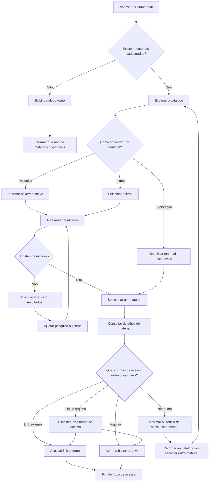

# User Flow — EduMaterial

**Versão:** 0.3  
**Status:** Em revisão documental  
**Escopo:** MVP do EduMaterial

## 1. Objetivo

Representar o fluxo de navegação de um professor que deseja encontrar, avaliar inicialmente e acessar um material educacional por meio do EduMaterial.

O fluxo contempla a exploração do catálogo, a pesquisa por palavras-chave, a aplicação de filtros, a consulta aos detalhes e o acesso ao recurso por link externo, arquivo hospedado na plataforma ou ambas as opções.

Este documento descreve o comportamento pretendido para o MVP. Não representa uma funcionalidade implementada ou validada com usuários reais.

## 2. Usuário principal

O fluxo tem como usuário prioritário o professor que procura materiais didáticos para utilizar em suas aulas.

A experiência deve permitir que esse usuário descubra recursos potencialmente relevantes, compreenda as informações disponíveis e identifique claramente como acessar o material.

## 3. Fluxo principal de navegação

O diagrama representa os principais caminhos previstos. O comportamento detalhado dos filtros, dos arquivos e das falhas de acesso ainda depende de especificações pendentes.

## 4. Descrição das etapas

| Etapa | Ação do usuário | Resposta esperada do sistema |
|---|---|---|
| Acesso inicial | Entra no EduMaterial | Apresenta o catálogo e as opções de navegação disponíveis. |
| Verificação do catálogo | Acessa a página inicial | Apresenta os materiais cadastrados ou informa que o catálogo está vazio. |
| Exploração | Percorre os materiais | Exibe os materiais disponíveis sem exigir uma pesquisa prévia. |
| Pesquisa | Informa palavras-chave | Apresenta os materiais correspondentes, conforme as regras de pesquisa definidas. |
| Filtragem | Seleciona filtros | Refina os resultados conforme os critérios selecionados. |
| Ausência de resultados | Não encontra materiais correspondentes | Informa a situação e permite alterar a pesquisa ou os filtros. |
| Seleção | Escolhe um material | Abre os detalhes do material selecionado. |
| Consulta aos detalhes | Analisa as informações do recurso | Apresenta os campos disponíveis e as formas de acesso cadastradas. |
| Acesso por link | Seleciona um link externo | Direciona o usuário ao endereço cadastrado. |
| Acesso por arquivo | Seleciona um arquivo | Permite abrir ou baixar o arquivo, conforme o formato e os recursos definidos. |
| Acesso por ambas as opções | Escolhe entre link e arquivo | Permite selecionar uma das formas de acesso disponíveis. |
| Ausência de acesso | Consulta um material sem link ou arquivo | Informa que não há forma de acesso cadastrada e mantém as informações descritivas disponíveis. |

## 5. Informações relevantes na página de detalhes

A página de detalhes deve apresentar, quando disponíveis e conforme os campos definidos para o produto:

- Título do material;
- Tipo ou formato do recurso;
- Etapa de ensino;
- Resumo;
- Descrição;
- Orientações de uso;
- Autoria ou fonte;
- Condições de utilização;
- Link externo;
- Arquivo hospedado na plataforma.

A obrigatoriedade de cada campo ainda precisa ser definida. A página de detalhes não depende de uma pré-visualização do conteúdo, pois essa funcionalidade está fora do escopo do MVP.

## 6. Decisões de experiência

- A pesquisa não deve ser o único caminho para encontrar materiais.
- O professor deve poder explorar o catálogo sem informar palavras-chave.
- A interface deve distinguir um catálogo vazio de uma pesquisa sem resultados.
- Os filtros ativos devem ser identificáveis e passíveis de remoção.
- A página de detalhes deve ajudar o usuário a compreender as características do material antes de acessá-lo.
- A interface deve identificar claramente as formas de acesso disponíveis.
- Link externo e arquivo hospedado são formas distintas de acesso.
- Quando ambas as opções estiverem disponíveis, a interface deve permitir identificar cada uma.
- Quando não houver uma forma de acesso cadastrada, a interface deve informar essa condição sem apresentar ações indisponíveis como funcionais.
- O fluxo não deve pressupor a existência de pré-visualização dos materiais no MVP.

## 7. Estados alternativos e situações excepcionais

### 7.1. Catálogo vazio

Ocorre quando não existem materiais cadastrados para exibição. A interface deve informar que o catálogo está vazio.

Esse estado é diferente de uma pesquisa sem resultados: no primeiro caso, não existem materiais cadastrados; no segundo, existem materiais no catálogo, mas nenhum corresponde aos critérios utilizados.

### 7.2. Pesquisa ou filtragem sem resultados

Ocorre quando a pesquisa ou os filtros não retornam materiais correspondentes.

A interface deve informar a situação e permitir que o usuário altere os termos da pesquisa ou remova os filtros.

### 7.3. Material sem forma de acesso cadastrada

Ocorre quando o material não possui link externo nem arquivo disponível.

A interface deve informar essa condição, manter as informações descritivas disponíveis e permitir que o professor retorne ao catálogo.

### 7.4. Link externo indisponível

Pode ocorrer quando o endereço cadastrado não funciona ou o recurso externo está indisponível.

A forma de comunicar essa falha e o comportamento específico da interface ainda precisam ser definidos.

### 7.5. Arquivo indisponível

Pode ocorrer quando um arquivo cadastrado não pode ser aberto ou baixado.

A interface deverá comunicar a indisponibilidade. O tratamento técnico dessa situação será especificado em uma etapa posterior.

## 8. Decisões, hipóteses e pendências

### 8.1. Decisões confirmadas

- O público prioritário são professores que procuram materiais para suas aulas.
- O usuário poderá explorar o catálogo, pesquisar e utilizar filtros.
- Os filtros previstos são tipo de material e etapa de ensino.
- A consulta aos detalhes faz parte do fluxo de descoberta e acesso.
- O acesso poderá ocorrer por link externo, arquivo hospedado na plataforma ou ambas as opções.
- A pré-visualização dos materiais não faz parte do MVP.
- Este documento descreve o fluxo pretendido, não uma implementação concluída.

### 8.2. Hipóteses de experiência

- A combinação de exploração, pesquisa e filtros pode facilitar a descoberta de materiais relevantes.
- Informações resumidas no catálogo podem ajudar o professor a decidir quais materiais consultar.
- Informações detalhadas e uma indicação clara das formas de acesso podem facilitar a escolha e o acesso aos recursos.

Esses pontos representam expectativas de experiência, não resultados comprovados por pesquisa com usuários.

### 8.3. Pendências

- Definir os campos pesquisáveis e as regras de correspondência.
- Definir as opções de cada filtro e a combinação entre pesquisa e filtros.
- Definir os campos obrigatórios e opcionais dos materiais.
- Definir os formatos de arquivo aceitos.
- Definir o tratamento de links e arquivos indisponíveis.
- Definir o comportamento visual de cada estado da interface.

## 9. Relação com os demais documentos

Este fluxo deve ser interpretado em conjunto com:

- [`product-brief.md`](../product/product-brief.md) — visão, público prioritário e escopo do produto;
- [`requisitos.md`](../product/requisitos.md) — requisitos funcionais e não funcionais;
- [`historias-de-usuario.md`](../product/historias-de-usuario.md) — necessidades dos usuários e critérios de aceitação;
- [`arquitetura-da-informacao.md`](./arquitetura-da-informacao.md) — organização do catálogo, dos resultados e dos detalhes;
- [`objetivos-de-ux.md`](./objetivos-de-ux.md) — objetivos e princípios da experiência;
- [`design-system.md`](./design-system.md) — direção visual e componentes previstos.

As decisões confirmadas de escopo devem orientar a revisão dos documentos. Questões ainda não resolvidas devem permanecer identificadas como pendências, sem serem tratadas como funcionalidades definidas.

## 10. Status e validação futura

O fluxo está documentado como uma proposta para o MVP. Não há, nesta etapa, evidência de implementação ou validação com usuários.

Caso o projeto avance para uma etapa futura de avaliação, o fluxo poderá orientar tarefas de usabilidade que verifiquem se professores conseguem:

1. Encontrar um material por exploração, pesquisa ou filtros;
2. Compreender as informações apresentadas nos resultados e nos detalhes;
3. Identificar as formas de acesso disponíveis;
4. Recuperar-se de uma pesquisa sem resultados;
5. Reconhecer quando um material não possui uma forma de acesso cadastrada.

A realização dessas atividades depende de uma etapa posterior do projeto e não faz parte da atual revisão documental.
