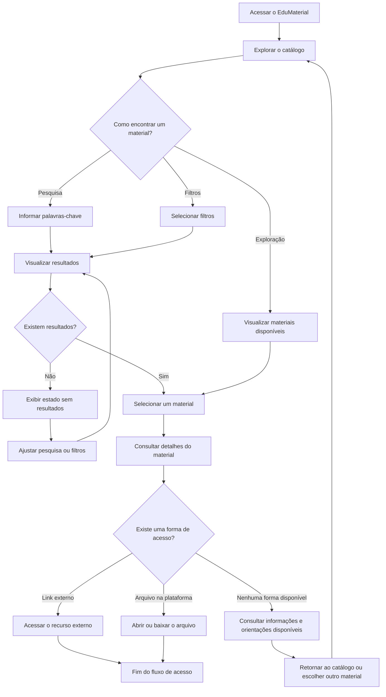

# User Flow — EduMaterial

**Versão:** 0.2  
**Status:** Em revisão documental  
**Escopo:** MVP do EduMaterial

## 1. Objetivo

Representar o fluxo de navegação de um professor que deseja encontrar, avaliar e acessar um material educacional por meio do EduMaterial.

O fluxo contempla a exploração do catálogo, a pesquisa por palavras-chave, a aplicação de filtros, a consulta aos detalhes do material e o acesso ao recurso, seja por um link externo, seja por um arquivo disponibilizado diretamente na plataforma.

Este documento descreve o comportamento pretendido para o MVP. Não representa uma funcionalidade implementada ou validada com usuários.

## 2. Usuário principal

O fluxo tem como usuário prioritário o **professor que procura materiais educacionais para utilizar em suas aulas**.

A experiência deve permitir que esse usuário descubra recursos relevantes, compreenda suas características antes de acessá-los e identifique claramente como obter o material.

## 3. Fluxo principal de navegação

## 4. Descrição das etapas

| Etapa | Ação do usuário | Resposta esperada do sistema |
|---|---|---|
| Acesso inicial | Entra no EduMaterial | Apresenta o catálogo e as opções de navegação disponíveis. |
| Exploração | Percorre os materiais disponíveis | Exibe os materiais cadastrados, sem exigir uma pesquisa prévia. |
| Pesquisa | Informa palavras-chave | Apresenta materiais correspondentes à pesquisa, quando houver. |
| Filtragem | Seleciona um ou mais filtros | Restringe os resultados conforme os critérios disponíveis. |
| Visualização dos resultados | Analisa as opções apresentadas | Exibe informações resumidas que ajudam a comparar os materiais. |
| Ausência de resultados | Não encontra materiais correspondentes | Informa que não foram encontrados resultados e permite rever a pesquisa ou os filtros. |
| Seleção | Escolhe um material | Abre a página ou área de detalhes do material selecionado. |
| Consulta aos detalhes | Analisa as informações do material | Apresenta os dados disponíveis para ajudar o professor a avaliar sua relevância. |
| Acesso por link externo | Seleciona o link de acesso | Disponibiliza a navegação para o recurso externo. |
| Acesso por arquivo | Seleciona o arquivo disponibilizado | Permite abrir ou baixar o arquivo, conforme o formato e os recursos da plataforma. |
| Indisponibilidade de acesso | Encontra um material sem link ou arquivo acessível | Informa a limitação e evita exibir uma ação de acesso que não possa ser concluída. |

## 5. Informações relevantes para a decisão

Na etapa de detalhes, o professor deve encontrar, quando disponíveis, informações que o ajudem a compreender o material antes de acessá-lo:

- Título do material;
- Tipo ou formato do recurso;
- Etapa de ensino ou público a que se destina;
- Resumo e descrição;
- Orientações de uso;
- Autoria ou fonte;
- Informações de licença ou condições de utilização, quando aplicáveis;
- Forma de acesso ao recurso.

A disponibilidade e a obrigatoriedade de cada campo devem seguir as definições do catálogo e dos requisitos do produto. Informações ainda não definidas não devem ser tratadas como funcionalidades confirmadas.

## 6. Decisões de experiência

- A pesquisa não deve ser o único caminho para encontrar materiais.
- O professor deve poder explorar o catálogo sem informar palavras-chave.
- A pesquisa, os filtros e a exploração devem conduzir à visualização dos materiais correspondentes.
- O estado sem resultados deve explicar a situação e oferecer uma possibilidade de recuperação, como ajustar a pesquisa ou limpar os filtros.
- A página de detalhes deve fornecer informações suficientes para apoiar a avaliação inicial do material.
- A forma de acesso deve estar identificada com clareza.
- Links externos e arquivos hospedados na plataforma devem ser tratados como formas distintas de acesso.
- Quando não houver uma forma de acesso disponível, a interface deve informar essa condição sem apresentar ações indisponíveis.
- O fluxo não deve pressupor a existência de pré-visualização dos materiais no MVP.

## 7. Estados alternativos e situações excepcionais

Além do fluxo principal, a experiência deve considerar os seguintes estados:

### 7.1 Catálogo vazio

Se ainda não houver materiais cadastrados, a interface deve informar que o catálogo está vazio. Esse estado é diferente de uma pesquisa sem resultados: no primeiro caso, não existem materiais disponíveis no catálogo; no segundo, a pesquisa ou os filtros não retornaram correspondências.

### 7.2 Pesquisa sem resultados

O sistema deve informar que não foram encontrados materiais para os critérios utilizados. O usuário deve poder ajustar as palavras-chave ou remover filtros e tentar novamente.

### 7.3 Material sem forma de acesso

Um material pode apresentar informações descritivas sem possuir um link externo ou arquivo disponível. Nessa situação, a interface deve deixar clara a limitação e não simular uma ação de acesso funcional.

### 7.4 Link externo indisponível

Se o destino externo não puder ser acessado, a falha pode estar fora do controle do EduMaterial. O comportamento específico para comunicar ou registrar esse problema ainda precisa ser definido.

### 7.5 Arquivo indisponível

Se um arquivo cadastrado não puder ser aberto ou baixado, a interface deverá comunicar a indisponibilidade. O tratamento técnico dessa situação depende da implementação futura.

## 8. Decisões confirmadas, hipóteses e pendências

### 8.1 Decisões confirmadas

- O público prioritário são professores que procuram materiais para suas aulas.
- O usuário poderá explorar o catálogo, pesquisar e utilizar filtros.
- O acesso aos materiais poderá ocorrer por links externos ou por arquivos hospedados na plataforma.
- A consulta aos detalhes fará parte do fluxo de descoberta e acesso.
- A pré-visualização dos materiais não faz parte do escopo do MVP.
- Este documento descreve o fluxo pretendido, não uma implementação concluída.

### 8.2 Hipóteses de experiência

- A combinação de exploração, pesquisa e filtros pode facilitar a descoberta de materiais relevantes.
- Informações resumidas no catálogo podem ajudar o professor a decidir quais materiais consultar.
- Informações detalhadas e uma indicação clara da forma de acesso podem reduzir dúvidas antes de utilizar um recurso.

Esses pontos representam expectativas de experiência, não resultados comprovados por pesquisa com usuários.

### 8.3 Decisões pendentes

- Definir quais filtros estarão disponíveis no MVP e se poderão ser combinados.
- Definir os campos obrigatórios e opcionais dos materiais.
- Especificar os formatos de arquivo aceitos e as ações de acesso correspondentes.
- Definir como serão apresentadas a autoria, a fonte e as condições de utilização dos materiais.
- Especificar o tratamento de links e arquivos indisponíveis.
- Definir o comportamento visual de cada estado da interface.

## 9. Relação com os demais documentos

Este fluxo deve ser interpretado em conjunto com:

- [`product-brief.md`](../product/product-brief.md) — visão, público prioritário e escopo do produto;
- [`requisitos.md`](../product/requisitos.md) — requisitos funcionais e não funcionais;
- [`historias-de-usuario.md`](../product/historias-de-usuario.md) — necessidades dos usuários e critérios de aceitação;
- [`arquitetura-da-informacao.md`](./arquitetura-da-informacao.md) — organização do catálogo, dos resultados e dos detalhes;
- [`objetivos-de-ux.md`](./objetivos-de-ux.md) — objetivos e princípios da experiência.

Caso haja divergências entre os documentos, as decisões de escopo confirmadas do produto devem orientar a revisão, enquanto questões ainda não resolvidas devem permanecer identificadas como pendências.

## 10. Status e validação futura

O fluxo está documentado como uma proposta para o MVP. Não há, nesta etapa, evidência de implementação ou validação com usuários.

Em uma fase futura, poderá ser avaliado por meio de testes de usabilidade que verifiquem se professores conseguem:

1. Encontrar um material por exploração, pesquisa ou filtros;
2. Compreender as informações apresentadas nos resultados e nos detalhes;
3. Identificar corretamente como acessar o material;
4. Recuperar-se de uma pesquisa sem resultados;
5. Reconhecer quando um recurso não possui uma forma de acesso disponível.

A realização dessas atividades depende de uma etapa posterior do projeto e não faz parte da atual revisão documental.
