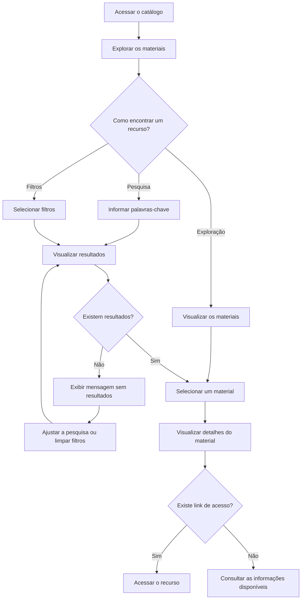

# User Flow — EduMaterial

## 1. Objetivo

Representar o fluxo principal de navegação de um professor que deseja encontrar um recurso educacional no EduMaterial.

## 2. Fluxo principal

## 3. Descrição das etapas

| Etapa | Ação do usuário | Resposta esperada do sistema |
|---|---|---|
| Catálogo | Acessa a página inicial | Exibe os materiais disponíveis |
| Descoberta | Pesquisa, filtra ou explora | Apresenta opções de materiais |
| Resultados | Analisa os resultados | Exibe os materiais correspondentes |
| Sem resultados | Não encontra o que procura | Informa a situação e permite tentar novamente |
| Detalhes | Seleciona um material | Apresenta informações sobre o recurso |
| Acesso | Escolhe abrir o material | Disponibiliza o link, quando existente |

## 4. Decisões de experiência

- A pesquisa não deve ser o único caminho para encontrar materiais.
- O usuário deve poder explorar o catálogo sem informar palavras-chave.
- A ausência de resultados precisa ter um estado visual próprio.
- A página de detalhes deve ajudar o usuário a entender o material antes de acessá-lo.
- Quando não houver link disponível, a interface deve evitar apresentar uma ação de acesso que não possa ser concluída.

## 5. Escopo e validação

Este fluxo representa o comportamento pretendido para o MVP, não uma funcionalidade já implementada ou testada.

Antes de considerar o fluxo validado, será necessário verificar se a navegação corresponde aos requisitos e testar se usuários conseguem concluir a tarefa com clareza.
