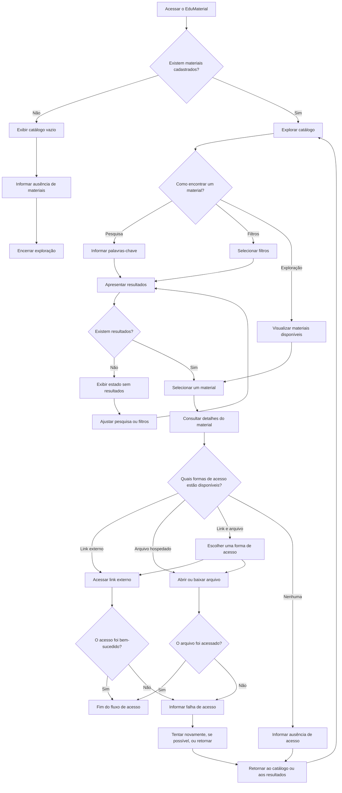

# User Flow — EduMaterial

**Versão:** 0.4  
**Status:** Em revisão documental  
**Escopo:** MVP do EduMaterial

## 1. Objetivo

Representar o fluxo de navegação de um professor que deseja encontrar, avaliar inicialmente e acessar um material educacional por meio do EduMaterial.

O fluxo contempla a exploração do catálogo, a pesquisa por palavras-chave, a aplicação de filtros, a consulta aos detalhes e o acesso ao recurso por link externo, arquivo hospedado na plataforma ou ambas as opções.

Também são considerados os estados de catálogo vazio, pesquisa sem resultados, ausência de formas de acesso e falhas durante a tentativa de acesso.

Este documento descreve o comportamento pretendido para o MVP. Não representa uma funcionalidade implementada ou validada com usuários reais.

## 2. Usuário principal

O usuário prioritário é o professor que procura materiais educacionais para preparar, complementar ou desenvolver suas aulas.

O fluxo deve permitir que esse usuário:

- Explore os materiais disponíveis.
- Pesquise recursos por palavras-chave.
- Refine os resultados por filtros.
- Compreenda as informações disponíveis sobre um material.
- Identifique as formas de acesso disponíveis.
- Retorne à navegação quando não encontrar resultados ou quando o acesso falhar.

## 3. Fluxo principal de navegação

O diagrama abaixo representa os principais caminhos previstos para o MVP.

O diagrama descreve o comportamento esperado, não uma implementação existente. O tratamento técnico de falhas, os formatos aceitos e os detalhes de interação permanecem sujeitos à especificação funcional.

## 4. Descrição das etapas

| Etapa | Ação do usuário | Resposta esperada do sistema |
|---|---|---|
| Acesso inicial | Entra no EduMaterial. | Apresenta o catálogo e as opções de navegação disponíveis. |
| Verificação do catálogo | Acessa a página inicial. | Apresenta os materiais cadastrados ou informa que o catálogo está vazio. |
| Exploração | Percorre os materiais. | Exibe os materiais disponíveis sem exigir uma pesquisa prévia. |
| Pesquisa | Informa palavras-chave. | Apresenta os materiais correspondentes, ordenados por relevância. |
| Filtragem | Seleciona filtros. | Refina os resultados conforme os critérios selecionados. |
| Ausência de resultados | Não encontra materiais correspondentes. | Informa a situação e permite alterar a pesquisa ou os filtros. |
| Seleção | Escolhe um material. | Abre os detalhes do material selecionado. |
| Consulta aos detalhes | Analisa as informações do recurso. | Apresenta os campos disponíveis e as formas de acesso cadastradas. |
| Acesso por link | Seleciona um link externo. | Direciona o usuário ao endereço cadastrado. |
| Acesso por arquivo | Seleciona um arquivo. | Permite abrir ou baixar o arquivo, conforme o comportamento definido para a plataforma. |
| Acesso por ambas as opções | Escolhe entre link e arquivo. | Permite selecionar uma das formas de acesso disponíveis. |
| Ausência de acesso | Consulta um material sem link ou arquivo disponível. | Informa que não há forma de acesso cadastrada e mantém as informações descritivas disponíveis. |
| Falha de acesso | Não consegue abrir o link ou arquivo. | Informa a falha e apresenta uma alternativa de recuperação, quando possível. |
| Retorno à navegação | Retorna após consultar um material ou encontrar uma falha. | Permite continuar explorando o catálogo. |

## 5. Pesquisa e filtros

### 5.1 Pesquisa por palavras-chave

A pesquisa deve considerar os seguintes campos:

1. Título.
2. Tipo de material.
3. Resumo.
4. Descrição.

O comportamento esperado inclui:

- Ignorar diferenças entre letras maiúsculas e minúsculas.
- Ignorar diferenças de acentuação.
- Aceitar correspondências parciais.
- Ordenar os resultados por relevância.
- Priorizar correspondências no título, seguidas pelo tipo de material, pelo resumo e pela descrição.

Exemplos do comportamento esperado:

- Uma pesquisa por `historia` deve poder localizar materiais com `história`.
- Uma pesquisa por `geog` deve poder localizar materiais com `geografia`.

A fórmula exata de relevância, os critérios de desempate e o tratamento de consultas com múltiplas palavras ainda precisam ser definidos.

### 5.2 Filtros

Os filtros previstos para o MVP são:

- Tipo de material.
- Etapa de ensino.

O usuário deverá conseguir identificar os filtros aplicados e compreender que eles restringem os resultados apresentados.

A combinação entre pesquisa e filtros, as opções disponíveis em cada filtro e o comportamento para remover critérios deverão seguir os requisitos funcionais consolidados.

### 5.3 Pesquisa ou filtragem sem resultados

Quando uma pesquisa ou combinação de filtros não retornar materiais, o sistema deverá:

1. Informar que não foram encontrados materiais correspondentes.
2. Permitir a alteração dos termos pesquisados.
3. Permitir a revisão ou remoção dos filtros.
4. Apresentar os resultados atualizados após a alteração dos critérios.

Esse estado deve ser diferenciado do catálogo vazio, que ocorre quando não há materiais cadastrados para exibição.

## 6. Informações da página de detalhes

A página de detalhes deverá apresentar, conforme a disponibilidade dos dados e os campos definidos para o produto:

- Título do material.
- Tipo de material.
- Etapa de ensino.
- Resumo.
- Descrição.
- Orientações de uso.
- Autoria ou fonte.
- Condições de utilização, quando aplicáveis.
- Link externo, quando disponível.
- Arquivo hospedado na plataforma, quando disponível.

A obrigatoriedade de cada campo ainda deverá ser consolidada na especificação dos metadados.

A página de detalhes não depende de uma pré-visualização do conteúdo. Essa funcionalidade está fora do escopo atual do MVP.

## 7. Cenários de acesso aos materiais

### 7.1 Material com link externo

O usuário consulta os detalhes e seleciona a ação de acesso à fonte externa.

O sistema deve direcioná-lo ao endereço cadastrado. Caso a tentativa falhe, deverá apresentar uma mensagem compreensível e permitir uma nova tentativa quando isso for viável.

### 7.2 Material com arquivo hospedado

O usuário consulta os detalhes e seleciona a ação correspondente ao arquivo.

O sistema deverá permitir abrir ou baixar o arquivo, de acordo com o comportamento que vier a ser definido para a plataforma e com o formato do recurso.

Caso o arquivo não possa ser acessado, a interface deverá informar a falha sem indicar sucesso indevidamente.

### 7.3 Material com link externo e arquivo hospedado

A interface deverá apresentar as duas opções de maneira distinta.

O usuário poderá escolher a forma de acesso mais adequada. A falha em uma opção não deverá ser apresentada como se necessariamente invalidasse a outra.

### 7.4 Material sem forma de acesso disponível

Quando não houver link externo nem arquivo hospedado, a interface deverá:

- Informar que não existe uma forma de acesso cadastrada.
- Manter disponíveis as informações descritivas do material.
- Não apresentar botões de acesso que não possam ser utilizados.
- Permitir que o usuário retorne ao catálogo ou aos resultados.

## 8. Estados alternativos e situações excepcionais

### 8.1 Catálogo vazio

Ocorre quando não existem materiais cadastrados para exibição.

A interface deve informar que o catálogo está vazio, sem sugerir que o usuário cometeu um erro na pesquisa.

### 8.2 Pesquisa ou filtragem sem resultados

Ocorre quando existem materiais no catálogo, mas nenhum corresponde aos critérios utilizados.

A interface deve permitir ajustar os termos da pesquisa ou os filtros aplicados.

### 8.3 Material sem forma de acesso cadastrada

Ocorre quando o material não possui link externo nem arquivo hospedado disponível.

A interface deve comunicar essa condição e manter as informações descritivas acessíveis.

### 8.4 Link externo indisponível

Ocorre quando o endereço cadastrado não funciona ou o recurso externo não pode ser acessado.

A interface deverá comunicar a falha e permitir uma nova tentativa quando for apropriado. O tratamento técnico específico ainda precisa ser definido.

### 8.5 Arquivo indisponível

Ocorre quando um arquivo cadastrado não pode ser aberto ou baixado.

A interface deverá informar a indisponibilidade. Os formatos aceitos, as verificações técnicas e os mecanismos de recuperação serão definidos em uma etapa posterior.

### 8.6 Falha ao carregar informações

Ocorre quando o sistema não consegue carregar o catálogo, os resultados ou os detalhes de um material.

A interface deverá distinguir a falha de carregamento de um estado vazio. Quando possível, deverá permitir tentar novamente.

## 9. Decisões de experiência

As seguintes decisões orientam o fluxo do MVP:

- A pesquisa não deve ser o único caminho para encontrar materiais.
- O professor deve poder explorar o catálogo sem informar palavras-chave.
- A interface deve distinguir um catálogo vazio de uma pesquisa sem resultados.
- Os filtros ativos devem ser identificáveis.
- A página de detalhes deve ajudar o usuário a compreender as características do material antes de acessá-lo.
- Link externo e arquivo hospedado são formas distintas de acesso.
- Quando ambas as opções estiverem disponíveis, cada uma deve ser identificável.
- Quando não houver forma de acesso cadastrada, a interface deve informar essa condição sem apresentar ações indisponíveis como funcionais.
- Falhas de acesso devem ser comunicadas de maneira compreensível.
- A navegação deve permitir retornar ao catálogo ou aos resultados após consultar um material.
- O fluxo não deve pressupor a existência de pré-visualização, edição, adaptação ou envio de materiais no MVP.

A preservação automática da pesquisa e dos filtros ao retornar dos detalhes é desejável, mas ainda precisa ser confirmada como requisito.

## 10. Decisões, hipóteses e pendências

### 10.1 Decisões confirmadas

- O público prioritário são professores que procuram materiais para suas aulas.
- O usuário poderá explorar o catálogo, pesquisar e utilizar filtros.
- Os campos pesquisáveis são título, tipo de material, resumo e descrição.
- A busca ignora diferenças de caixa e acentuação e aceita correspondências parciais.
- Os resultados são ordenados por relevância, com prioridade para título, tipo de material, resumo e descrição.
- Os filtros previstos são tipo de material e etapa de ensino.
- A consulta aos detalhes faz parte do fluxo de descoberta e acesso.
- O acesso poderá ocorrer por link externo, arquivo hospedado ou ambas as opções.
- A ausência de formas de acesso deve ser comunicada claramente.
- A pré-visualização, a edição, a adaptação e o envio de materiais não fazem parte do MVP atual.
- Este documento descreve o fluxo pretendido, não uma implementação concluída.

### 10.2 Hipóteses de experiência

- A combinação de exploração, pesquisa e filtros pode facilitar a descoberta de materiais relevantes.
- Informações resumidas no catálogo podem ajudar o professor a decidir quais materiais consultar.
- Informações detalhadas e formas de acesso claramente identificadas podem facilitar a escolha e o acesso aos recursos.
- Mensagens claras de falha podem ajudar o usuário a compreender problemas de acesso e decidir como prosseguir.

Esses pontos representam expectativas de experiência, não resultados comprovados por pesquisas com usuários.

### 10.3 Pendências

- Definir a fórmula de relevância e os critérios de desempate.
- Especificar o tratamento de consultas com múltiplas palavras.
- Definir as opções dos filtros e as regras de combinação entre pesquisa e filtros.
- Definir os campos obrigatórios e opcionais dos materiais.
- Definir os formatos de arquivo aceitos e os limites aplicáveis.
- Definir o tratamento técnico de links e arquivos indisponíveis.
- Definir o comportamento visual dos estados de carregamento, erro e acesso indisponível.
- Confirmar se pesquisa e filtros serão preservados ao retornar dos detalhes.

## 11. Relação com os demais documentos

Este fluxo deve ser interpretado em conjunto com:

- `README.md` — apresentação geral e escopo do projeto.
- `docs/product/product-brief.md` — visão, público prioritário e escopo do produto.
- `docs/product/requisitos.md` — requisitos funcionais e não funcionais.
- `docs/product/historias-de-usuario.md` — necessidades dos usuários e critérios de aceitação.
- `docs/product/backlog.md` — tarefas, prioridades e andamento.
- `docs/ux-ui/arquitetura-da-informacao.md` — organização do catálogo, dos resultados e dos detalhes.
- `docs/ux-ui/objetivos-de-ux.md` — objetivos e princípios da experiência.
- `docs/ux-ui/design-system.md` — direção visual e componentes previstos.

As decisões confirmadas de escopo devem orientar a revisão dos documentos. Questões ainda não resolvidas devem permanecer identificadas como pendências, sem serem tratadas como funcionalidades definidas.

## 12. Status e validação futura

O fluxo está documentado como uma proposta para o MVP. Não há, nesta etapa, evidência de implementação ou validação com usuários.

Caso o projeto avance para uma etapa futura de avaliação, o fluxo poderá orientar tarefas de usabilidade que verifiquem se professores conseguem:

1. Encontrar um material por exploração, pesquisa ou filtros.
2. Compreender as informações apresentadas nos resultados e nos detalhes.
3. Identificar as formas de acesso disponíveis.
4. Recuperar-se de uma pesquisa sem resultados.
5. Reconhecer quando um material não possui uma forma de acesso cadastrada.
6. Compreender uma falha de acesso e identificar as alternativas disponíveis.

A realização dessas atividades depende de uma etapa posterior do projeto e não faz parte da atual revisão documental.

## 13. Considerações metodológicas

O documento descreve uma proposta de navegação, não uma funcionalidade já implementada ou validada.

A pesquisa por meio do Google Forms foi abandonada. Dados simulados não devem ser apresentados como respostas reais de professores ou evidência empírica de usabilidade.

Caso sejam realizadas avaliações futuras, seus métodos, participantes, resultados e limitações deverão ser documentados separadamente.
